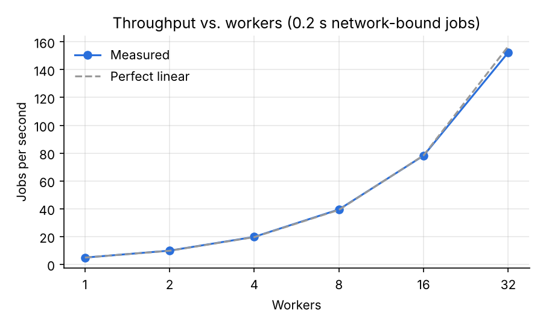
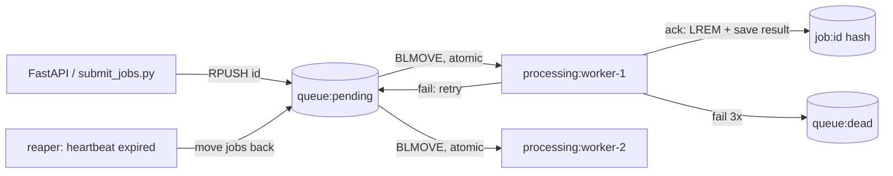

# Distributed ML Training Platform

A job queue on Redis that runs ML training jobs across many worker processes, with no lost jobs when workers crash.

- **Atomic claiming:** each job goes to exactly one worker (`BLMOVE` into a per-worker processing list).
- **Crash recovery:** workers send heartbeats; when one stops, its jobs go back on the queue.
- **Retries and a dead-letter queue:** failed jobs retry up to 3 times, then move to `queue:dead`.
- **Exactly-once results:** a worker can only record a result for a job it still owns, so a slow worker that was presumed dead can't overwrite the real result.
- **Training jobs:** scikit-learn Logistic Regression and Random Forest, with optional GridSearchCV tuning (5-fold cross-validation).
- **API and dashboard:** FastAPI for submitting and inspecting jobs, Next.js frontend for submitting them.

## Results

From `benchmarks/run_benchmark.py` on a 2-core Linux VM (full numbers in [benchmarks/RESULTS.md](benchmarks/RESULTS.md)):

| What | Result |
|---|---|
| Crash recovery | 3 of 8 workers killed with SIGKILL mid-run: **400/400 jobs completed, 0 lost, 0 duplicate results** |
| Scaling (network-bound jobs) | **31x throughput at 32 workers** vs. 1 worker (152 vs. 4.9 jobs/s) |
| Queue overhead | **~2,900 jobs/s** through claim, run and ack with 8 workers |
| Bug in the original version | Under 16 concurrent workers the old queue double-claimed 994 of 2,000 jobs and never ran 989 |



CPU-bound jobs scale with cores, not workers: on this 2-core machine they top out at 2x. The network-bound benchmark uses 0.2 s jobs that wait like an API call, which is the workload the queue is built for.

## How it works



1. **Submit:** the job's fields go in a `job:<id>` hash and its id is pushed onto `queue:pending`.
2. **Claim:** a worker runs `BLMOVE queue:pending queue:processing:<worker>`. The move is one atomic Redis command, so two workers can never get the same job.
3. **Run:** the worker trains the model. A background thread refreshes the worker's heartbeat key (TTL 10 s) every 2 s.
4. **Ack or fail:** a Lua script removes the id from the worker's processing list and saves the result, in one step. If the id isn't there anymore, the result is dropped. On failure the job goes back on the queue, or to the dead-letter queue after 3 attempts.
5. **Reap:** every worker (and the monitor) checks for workers whose heartbeat expired and moves their jobs back to the front of the queue.

Design decisions and tradeoffs are in [DESIGN.md](DESIGN.md).

## Run it

```bash
docker compose up --build --scale worker=4      # Redis, workers, monitor, API on :8000
PYTHONPATH=src python src/scripts/submit_jobs.py  # submit a sample batch (needs REDIS_HOST/PORT)
curl localhost:8000/stats

cd frontend && npm install && npm run dev       # dashboard on :3000
```

Submit a job over HTTP. A list value becomes a GridSearchCV grid:

```bash
curl -X POST localhost:8000/create-job -H 'Content-Type: application/json' \
  -d '{"type": "Random Forest", "description": "Digits", "parameters": {"n_estimators": [50, 100, 200]}}'
```

## Tests and benchmarks

Both start their own `redis-server`, so Redis must be installed locally.

```bash
pip install -r requirements-dev.txt
python -m pytest tests                  # claiming, retries, dead-letter, crash recovery, end-to-end training
python benchmarks/run_benchmark.py      # about 3 minutes; writes benchmarks/RESULTS.md and scaling.png
```

## Project layout

```
src/job_queue.py        queue operations and the Lua scripts for ack, fail and reap
src/worker.py           worker loop, heartbeat thread, graceful shutdown
src/handlers.py         job kinds: train, plus simulated_io and cpu for benchmarks
src/models.py           dataset loading and training
src/training_models/    Logistic Regression and Random Forest
src/api/main.py         FastAPI: /create-job, /jobs, /jobs/{id}, /stats
src/scripts/            worker entrypoint, monitor, sample job submitter
tests/                  pytest suite against a real Redis
benchmarks/             benchmark script and results
frontend/               Next.js dashboard
```
